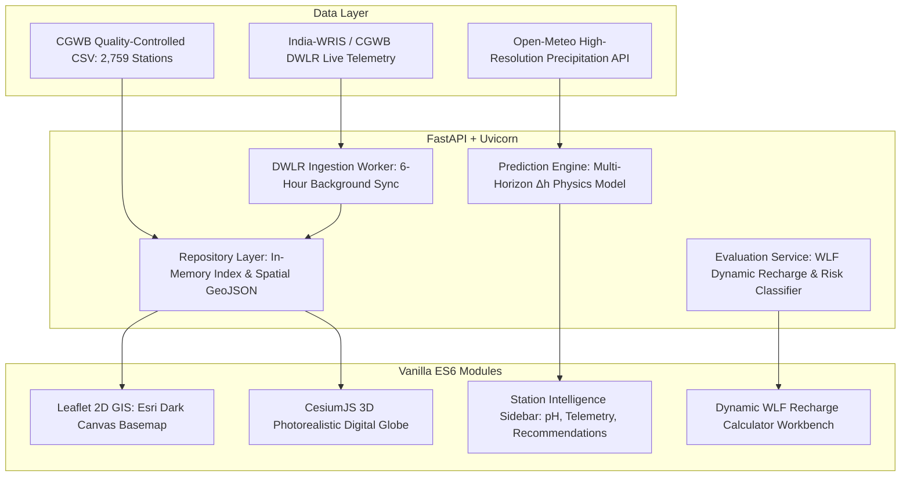

# CGWB HydroEval — Core Architecture & System Blueprint (BRAIN.md)

## 1. Executive Overview
**CGWB HydroEval** is an asynchronous full-stack hydrogeological evaluation and predictive advisory platform designed to assess 22 years of quality-controlled Central Ground Water Board (CGWB) monitoring datasets, ingest real-time 6-hour Digital Water Level Recorder (DWLR) telemetry, and forecast multi-horizon aquifer replenishment using real-time atmospheric precipitation models.

---

## 2. System Architecture Layers



---

## 3. Directory Layout & Layer Responsibilities

```
ground water level evaluation/
├── backend/
│   └── app/
│       ├── core/               # Configuration, logging, exception handlers
│       │   ├── config.py       # Pydantic Settings & environment variables
│       │   ├── errors.py       # Domain RFC 9457 exceptions (NotFoundError, BadRequestError)
│       │   └── logging.py      # Structured centralized logger
│       ├── repositories/       # In-memory datasets, indexing, spatial GeoJSON caching
│       │   └── groundwater_repo.py
│       ├── routers/            # REST API endpoints (versioned /api/v1)
│       │   ├── dwlr.py         # DWLR status & live manual sync endpoints
│       │   ├── evaluation.py   # Dynamic WLF recharge & risk assessment routes
│       │   ├── health.py       # Liveness (/healthz) & readiness (/readyz) probes
│       │   ├── stats.py        # National, state-level, and filter distribution stats
│       │   ├── weather.py      # Open-Meteo rainfall impact integration routes
│       │   └── wells.py        # 2,759 well index, autocomplete, and detail routes
│       ├── schemas/            # Canonical Pydantic v2 data models & request/response contracts
│       │   ├── common.py       # PaginatedResponse & ErrorDetail models
│       │   ├── evaluation.py   # Recharge & Risk calculation schemas
│       │   ├── stats.py        # Overview & state-level summary schemas
│       │   └── well.py         # WellDetail, WellSummary, GeoJSON schemas
│       ├── services/           # Pure business logic & hydrogeological modeling
│       │   ├── dwlr_service.py # Telemetry parser & India-WRIS automated updater
│       │   ├── evaluation_service.py # WLF volumetric recharge calculations
│       │   ├── groundwater_service.py # Facade for station operations & filters
│       │   ├── prediction_engine.py  # 6-horizon Δh prediction engine
│       │   └── weather_service.py    # Open-Meteo forecast & well health scoring
│       └── main.py             # FastAPI factory, lifespan manager, 6h scheduler, static mounting
├── data/
│   └── dwlr/                   # Ingested DWLR live telemetry CSV & update manifests
│       ├── dwlr_telemetry_latest.csv
│       └── update_manifest.json
├── frontend/
│   ├── static/
│   │   ├── css/
│   │   │   └── style.css       # Clean dark-mode CSS tokens, layouts, responsive components
│   │   └── js/
│   │       ├── api.js          # REST client wrapper for /api/v1
│   │       ├── app.js          # UI controller, state sync, search ranker, event coordinator
│   │       ├── charts.js       # Chart.js rendering (historical, seasonal, annual recharge)
│   │       └── map.js          # Leaflet 2D (Esri Dark) & CesiumJS 3D Globe controller
│   └── templates/
│       └── index.html          # Single-Page Application (SPA) entrypoint
├── tests/
│   ├── test_api.py             # Pytest test suite
│   └── test_api_unittest.py    # Python standard library unittest suite
├── []CGWB]-Quality_controlled_groundwater_levels_over_India/
│   └── Output/
│       └── CGWB_India_filtered_GWLs_ref_sy_2000_2022.csv # Core quality-controlled dataset
├── dwlr_updater.py             # Standalone CLI worker for scheduled DWLR synchronization
├── run.py                      # Application bootstrap & ASGI Uvicorn runner
├── requirements.txt            # Python dependencies (pinned for reproducibility)
├── .gitignore                  # Git hygiene rules (ignoring __pycache__, temp files)
├── BRAIN.md                    # System architecture blueprint & component catalog
└── HYDROEVAL_FEATURE_FORMULAS_AND_CALCULATION_GUIDE.md # Scientific & mathematical calculation guide
```

---

## 4. Key Engineering Standards Followed
1. **Pydantic Contract-First Integration**: All requests and responses strictly validate through `backend/app/schemas/`.
2. **Zero Hardcoded Secrets**: Fully configurable via environment variables in `backend/app/core/config.py`.
3. **No Frontend Framework Bloat**: Pure ES6 modules with sub-millisecond DOM responsiveness and zero build overhead.
4. **Watermark-Free Spatial GIS**: Uses Esri World Dark Gray Canvas with native scale handling up to zoom 19.
5. **Real-time Asynchronous Pipeline**: Background workers leverage Python `asyncio` inside the FastAPI lifespan without blocking incoming HTTP traffic.
