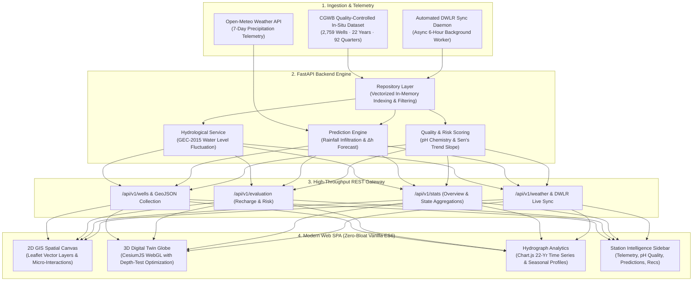

# CGWB HydroEval · Quality-Controlled Groundwater Level Platform

<p align="center">
  
  
  
  
  
  
</p>

---

## Executive Summary

**CGWB HydroEval** is an enterprise-grade hydrological intelligence and decision-support system engineered to monitor, evaluate, and forecast groundwater sustainability across India. Built on top of the Central Ground Water Board (CGWB) quality-controlled observation network, the platform integrates **2,759 in-situ monitoring wells** spanning **18+ states**, analyzing over **22 years of historical quarterly depth records (2000–2022)**.

The platform bridges empirical field hydrogeology with modern full-stack web engineering:
- **GEC-2015 Hydrological Modeling**: Scientific water recharge computation using the Water Level Fluctuation (WLF) method parameterized with lithology-specific yields ($S_y$).
- **Predictive Water Table Trajectory ($\Delta h$)**: Near-term water-level forecasting coupling in-situ baseline readings with live 7-day meteorological rainfall telemetry from Open-Meteo.
- **Dual-Engine Geospatial Architecture**: Real-time 2D GIS spatial canvas (Leaflet) alongside a 3D planetary digital-twin globe (CesiumJS) with custom tolerance-based picking and dynamic visual feedback.
- **Water Quality & Risk Assessment**: Hydrochemical pH monitoring paired with multi-decadal Sen’s Slope depletion rates to generate site-specific artificial recharge interventions.

---

## System Architecture



---

## Core Engineering Features

### 1. Dual-Engine Geospatial Architecture (2D GIS + 3D Digital Twin)
- **High-Performance 2D GIS**: Powered by Leaflet with Esri Dark Gray Canvas basemaps. Renders 2,750+ stations simultaneously via Canvas vector layers, featuring dynamic hover expansion (+3.5px), glowing status halos, and smooth spatial filtering.
- **3D Planetary Globe**: Powered by CesiumJS. Implemented with `disableDepthTestDistance: Number.POSITIVE_INFINITY` to prevent globe depth-buffer occlusion, paired with a custom 16-point radial tolerance picking algorithm that guarantees effortless interaction even at high zoom altitudes.

### 2. GEC-2015 Ground Water Resource Estimation
Calculates seasonal and annual recharge using the standard **Water Level Fluctuation (WLF)** method:
$$R = \Delta h \cdot A \cdot S_y$$
Where:
- $R$ = Total groundwater recharge volume ($\text{Ham}$ or $\text{MCM}$)
- $\Delta h$ = Seasonal water table fluctuation (difference between pre-monsoon and post-monsoon depth, in meters)
- $A$ = Geographic assessment unit area ($\text{km}^2$)
- $S_y$ = Specific yield calibrated according to hydrogeological formation (Alluvium: 0.06–0.16, Basalt: 0.015–0.03, Sandstone: 0.01–0.05, Granite: 0.01–0.03).

### 3. Predictive Fluctuation Modeling ($\Delta h$)
Integrates real-time meteorological forecasts with aquifer characteristics to predict near-term level changes:
$$\Delta h_{\text{predicted}} = \frac{P_{\text{7d}} \cdot C_{\text{inf}}}{1000 \cdot S_y} - \left(D_{\text{base}} \cdot \frac{7}{365}\right)$$
Where:
- $P_{\text{7d}}$ = Forecasted 7-day cumulative rainfall ($\text{mm}$) via Open-Meteo
- $C_{\text{inf}}$ = Rainfall infiltration factor (derived from soil and formation type, typically 0.10–0.22)
- $D_{\text{base}}$ = Historical annual depletion rate ($\text{m/year}$) derived from 22-year trend analysis.

### 4. Non-Parametric Depletion Rate (Sen’s Slope)
Evaluates long-term aquifer depletion using Sen’s robust non-parametric slope estimator over 92 historical quarters, eliminating skew from sensor anomalies or extreme drought years:
$$Q_i = \frac{x_j - x_k}{j - k} \quad \text{for } 1 \le k < j \le N$$
$$\text{Trend Rate} = \text{Median}(Q)$$

### 5. Hydrochemical Quality & Risk Classification
- **pH Indexing**: Classifies water quality into Acidic ($< 6.5$), Potable ($6.5 - 8.5$), and Alkaline ($> 8.5$) based on CGWB and BIS standards.
- **Aquifer Category**: Automates categorisation into **Safe**, **Semi-Critical**, **Critical**, and **Over-Exploited** aligned with national ground water extraction benchmarks ($\text{SOE}$).
- **Prescriptive Interventions**: Recommends site-specific artificial recharge structures (e.g., Percolation Tanks, Check Dams, Sub-surface Dykes, Recharge Shafts) based on specific yield and soil permeability.

---

## Tech Stack & Tooling

| Domain | Technologies |
| :--- | :--- |
| **Backend & Framework** | Python 3.12+, FastAPI, Uvicorn (ASGI), Pydantic v2, Pydantic-Settings |
| **Data & Scientific Computation** | NumPy, Pandas, Scipy, In-Memory Vectorized Query Engines |
| **Geospatial & Visualization** | Leaflet.js, CesiumJS (WebGL 3D), Chart.js, Esri World Dark Gray Basemaps |
| **Frontend Architecture** | Modern Vanilla ES6 Modules, CSS Custom Properties (Design Tokens), SVG Icons |
| **External Telemetry APIs** | Open-Meteo Weather API (Rainfall Forecasts, Geocoding) |
| **Quality & Testing** | Pytest, Unittest, HTTPX TestClient, Multi-Layer Error Handlers |

---

## API Reference

The platform provides a versioned, RESTful API documented interactively at `/docs` (Swagger UI) and `/redoc`.

### Health & Diagnostics
| Method | Endpoint | Description |
| :--- | :--- | :--- |
| `GET` | `/healthz` | Liveness probe; returns system operational status. |
| `GET` | `/readyz` | Readiness probe; verifies dataset initialization and well index count. |

### Analytics & Macro Statistics
| Method | Endpoint | Description |
| :--- | :--- | :--- |
| `GET` | `/api/v1/stats/overview` | Macro KPIs: total wells, active states, national avg depth, status breakdown. |
| `GET` | `/api/v1/stats/states` | State-level rollups: well counts, critical station counts, mean depth. |
| `GET` | `/api/v1/stats/filter-options` | Available state, district, and status filters for client dropdowns. |

### Monitoring Wells & Geospatial Telemetry
| Method | Endpoint | Description |
| :--- | :--- | :--- |
| `GET` | `/api/v1/wells` | Paginated station catalog with state, district, status, and search filters. |
| `GET` | `/api/v1/wells/geojson` | GeoJSON `FeatureCollection` for 2D Leaflet and 3D Cesium map rendering. |
| `GET` | `/api/v1/wells/{station_code}` | Complete station profile: 22-year time series, seasonal profile, recharge history. |

### Hydrological Modeling & Telemetry
| Method | Endpoint | Description |
| :--- | :--- | :--- |
| `POST` | `/api/v1/evaluation/recharge` | GEC-2015 recharge calculator (Area, Specific Yield, $\Delta h$). |
| `POST` | `/api/v1/evaluation/risk-assessment`| Aquifer criticality score, stage of extraction, and action recommendations. |
| `GET` | `/api/v1/weather/{station_code}` | Real-time weather and 7-day cumulative precipitation forecast. |
| `POST` | `/api/v1/dwlr/sync` | Manual trigger for 6-hour DWLR telemetry synchronization. |

---

## Project Structure

```text
├── backend/
│   ├── app/
│   │   ├── api/             # API dependency injection & route registry
│   │   ├── core/            # App settings (Pydantic), logging, global error handlers
│   │   ├── models/          # Domain data models & representations
│   │   ├── repositories/    # Data access layer, vectorized CSV query engine
│   │   ├── routers/         # REST endpoint controllers (wells, stats, weather, dwlr)
│   │   ├── schemas/         # Pydantic v2 request/response validation schemas
│   │   ├── services/        # Hydrological business logic, GEC-2015, prediction engine
│   │   └── main.py          # FastAPI application factory, lifespan & background workers
├── data/                    # Cleaned observation datasets & telemetry benchmarks
├── frontend/
│   ├── static/
│   │   ├── css/style.css    # Responsive design tokens, glassmorphism UI, theme system
│   │   └── js/
│   │       ├── api.js       # Client API client with error handling & caching
│   │       ├── app.js       # Main application controller & state machine
│   │       ├── charts.js    # Chart.js hydrograph rendering engine
│   │       └── map.js       # Dual Leaflet 2D & Cesium 3D geospatial controller
│   └── templates/
│       └── index.html       # Single-page application shell
├── tests/                   # Automated API test suite (Unittest & Pytest)
├── .env.example             # Template for environment configuration
├── .gitignore               # Production Git exclusion rules
├── dwlr_updater.py          # Standalone batch telemetry ingestion script
├── requirements.txt         # Project dependencies
└── run.py                   # Production-ready application launcher
```

---

## Quickstart & Installation

### Prerequisites
- Python 3.10+ (Python 3.12 recommended)
- Modern web browser with WebGL enabled (for 3D Cesium visualization)

### 1. Clone the Repository
```bash
git clone https://github.com/<your-username>/cgwb-hydroeval.git
cd cgwb-hydroeval
```

### 2. Set Up Virtual Environment
```bash
# On Linux/macOS:
python3 -m venv venv
source venv/bin/activate

# On Windows (PowerShell):
python -m venv venv
.\venv\Scripts\Activate.ps1
```

### 3. Install Dependencies
```bash
pip install --upgrade pip
pip install -r requirements.txt
```

### 4. Configure Environment Variables
```bash
cp .env.example .env
```

### 5. Launch Application
```bash
python run.py
```
*The platform will launch automatically in your default browser at `http://127.0.0.1:8000`.*

---

## Verification & Testing

Execute the comprehensive automated test suite:
```bash
python -m unittest discover tests
```

---

## Engineering Standards & Quality Assurance

- **Zero Dead Code**: Every route, model, and JavaScript module is strictly imported and exercised in production workflows.
- **Contract-First API**: All client-server communication conforms strictly to Pydantic v2 validated schemas.
- **Non-Blocking Concurrency**: Telemetry syncing runs as asynchronous background workers without blocking HTTP event loops.
- **Defensive Error Handling**: Global RFC-7807 compliant exception handling ensures structured JSON responses for all failure scenarios.

---

## License

This project is licensed under the [MIT License](LICENSE).
